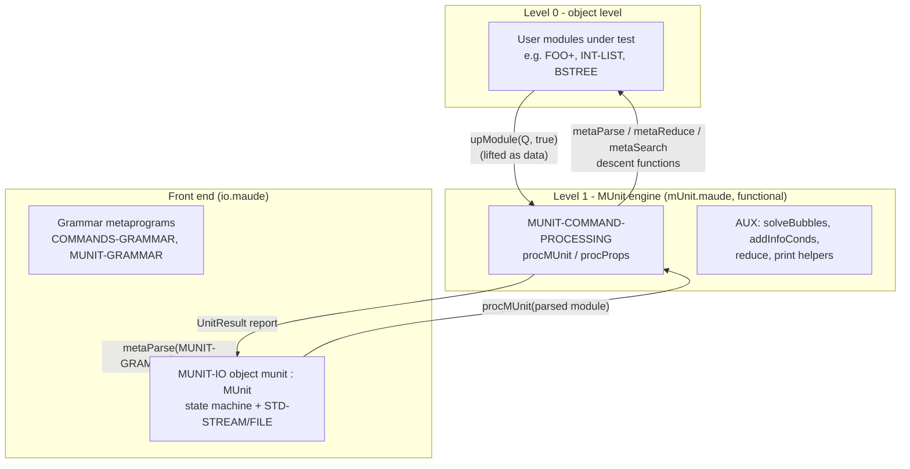
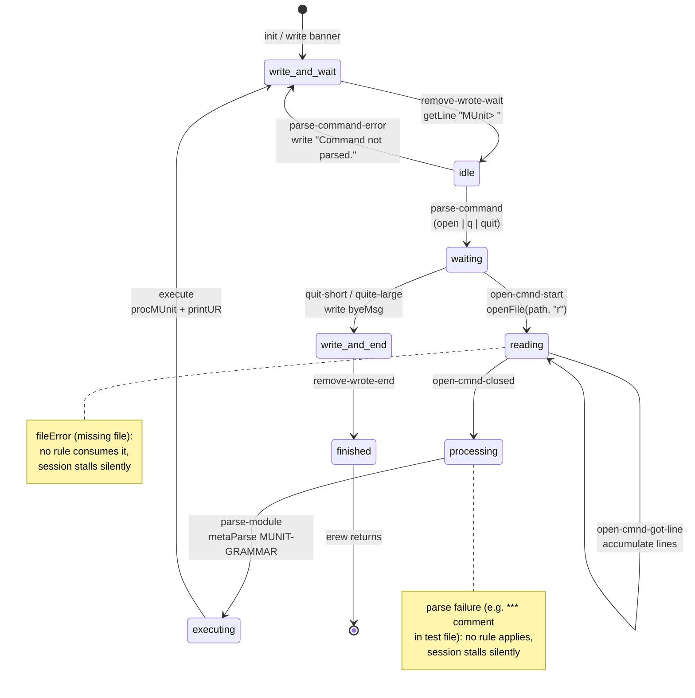

# MUnit — Architecture

> System architecture and design patterns. Generated by codebase-summary.

## Architectural Overview

MUnit is a **reflective metalanguage application** in the sense of the Maude manual (user-interfaces chapter): it uses Maude's own reflective tower to compute *about* the user's modules. Three tiers:

The engine never *simulates* the user's rewriting; it delegates every computation to **META-LEVEL descent functions** (`metaReduce` for equational assertions, `metaSearch` for reachability/search assertions, `metaParse` to interpret raw assertion text in the module under test). This is the standard efficiency contract for reflective tools.

## Two-Level Syntax via Bubbles

Test-file syntax is defined by a metaprogrammed grammar, not by a hand-written parser:

- `MUNIT-SIGNATURE` (in `io.maude`) declares the *shape* of test declarations: `munit_is_endu : @Token@ @MUnitPredList@ -> @MUnitModule@` plus one constructor per assertion sort `@MUnitPredicate@` (e.g. `assertEqual : @Bubble@ @Bubble@ -> @MUnitPredicate@`).
- `META-MUNIT-SIGN` builds `MUNIT-GRAMMAR` **as an `FModule` data term**: a module expression `fmod 'MUNIT-GRAMMAR is including 'QID-LIST ... endfm` extended with `token`, `neTokenList`, and `bubble` operators carrying `special(id-hook('Bubble, ...) ...)` attributes. The `bubble` hook collects arbitrary balanced-parenthesized token runs, excluding Maude keywords (`eq`, `rl`, `var`, `endm`, ...), so assertion arguments are captured as **raw unparsed text**.
- At execution time, `solveBubbles(M, 'bubble[T])` (in `AUX`) re-parses each bubble's token list with `metaParse(M, QIL, anyType)` where **M is the module under test** — the deferral that makes two-level languages work.
- For search conditions (`hasSolution`/`noSolution`), `solveBubblesCond` parses against `'@Condition@` in a module *extended on the fly* by `addInfoConds(M)`, which injects `@Sort@` constants, `_: sort` membership conditions, `Bool < @Condition@` subsorting (when `Bool` exists), and the condition connectives `_/\_`, `_=_`, `_:=_`, `_=>_`. This is how conditions like `inStock(T:BSTree, "b")` become parseable.

## Front-End Pattern: Object State Machine + External Objects

`MUNIT-IO` (system module in `io.maude`) implements the interactive session with the canonical Maude user-interface pattern:

- A single object `munit : MUnit` whose attributes carry the session state: `input:` (last parsed command), `state:` (a `State` sort with 8 constructors), `data:` (accumulated file text), `parsed:` (parsed test module).
- **STD-STREAM** messages for terminal dialogue: `getLine(stdin, munit, "MUnit> ")` / `gotLine`, `write(stdout, munit, S)` / `wrote`.
- **FILE** manager messages for `open PATH`: `openFile(fileManager, munit, S, "r")` → `openedFile` → `getLine`/`gotLine` accumulation → `closeFile` → `closedFile`.
- The initial configuration `run = <> < munit : MUnit | initAtS > write(stdout, munit, mu-banner)` is driven by **`erew run .`**; the `<>` portal is what allows external messages in.
- Session teardown: `q`/`quit` → `byeMsg` write → state `finished` → `erew` returns → the `eof` command in `io.maude` discards the remaining (dead) lines of the file.

## Object State Machine

The two `note` boxes are verified failure modes (see `review_notes.md`): neither `[parse-module]` nor the `open` path has an error branch, so those failures leave the object stuck and `erew` simply returns.

## Design Principles Observed

- **Descent over simulation**: the object level does all real work (`metaReduce`, `metaSearch`), keeping the reflective tower one level deep.
- **Memoization at hot boundaries**: `solveBubbles`, `reduce`, `addOps`, `addSorts`, `addSubsorts` are `[memo]` — each bubble is parsed against a module at most once.
- **Verdicts as equations over structured failure**: every assertion is a family of conditional equations on `procProps` returning `< correct, failed, info >` triples; parse failures inside an assertion are *data* ("No parse for ..."), not exceptions.
- **Reports are QidLists with color tokens** (`'\!` bold, `'\r` red, `'\g` green, `'\o` reset) pretty-printed via `metaPrettyPrint` with `mixfix number rat format` options.
