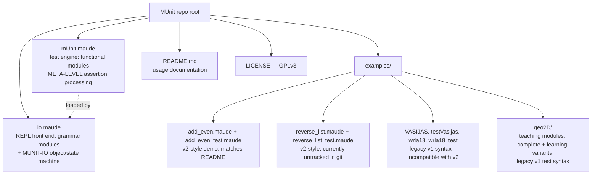

# MUnit — Codebase Information

> Metadata file for the MUnit knowledge base. Generated by the codebase-summary process; exclude `.agents/planning` from any analysis.

## Project Identity

| Field | Value |
|---|---|
| Name | MUnit — "a unit testing framework for Maude" |
| Version | 2.0 (banner dated October 23rd, 2025) |
| Language | Maude (rewriting-logic specification language), 100% of the code |
| Interpreter | Maude 3.5.1 (verified end-to-end with the `maude` binary) |
| License | GNU GPL v3 |
| Upstream | https://github.com/ariesco/MUnit |
| Build system | None — the Maude interpreter loads sources directly |
| Runtime requirement | Maude started with `-allow-files` (file I/O is flag-gated) |

## What MUnit Does

MUnit is an interactive unit-testing REPL for Maude modules. Users write test files of the form `munit MODULE is ASSERTIONS endu`, where `MODULE` is an already-loaded Maude module and `ASSERTIONS` are checks such as `assertEqual(3, add(1, 2))`, `assertTrue(even(8))`, or `hasSolution(1, 0, *, unbounded, cond)`. The tool re-parses each assertion's raw text in the module under test, evaluates it with Maude's META-LEVEL descent functions (`metaReduce`, `metaSearch`), and prints a pass/fail report with totals.

## Repository Structure



Note: `.agents/` (this summary and the excluded `planning/` folder) is not part of the tool.

## Technology Stack

- **Core Maude prelude modules used** (see `dependencies.md` for the full map):
  - `META-LEVEL` — reflection: `upModule`, `metaParse`, `metaReduce`, `metaSearch`, `metaPrettyPrint`, sort predicates (`sortLeq`, `sameKind`, `getSorts`)
  - `CONVERSION` — `upTerm`/`downTerm` between object and metalevel
  - `LEXICAL` — `tokenize` / `printTokens`
  - `STD-STREAM`, `FILE`, `CONFIGURATION` — external objects, messages, object-oriented state machine in `io.maude`
  - `QID-LIST`, `QID`, `NAT`, `BOOL`, `STRING` — data plumbing
- **Key Maude mechanisms**: bubble-based two-level grammars (`id-hook Bubble`), metarepresented modules built as data (`addImports`, `addOps`, `addSorts`, `addSubsorts`), `erewrite`-driven I/O loop.

## Files and Their Roles

| File | Role |
|---|---|
| `mUnit.maude` | Pure functional engine: `UNIT-RESULT`, `AUX` (metaterm utilities), `MUNIT-COMMAND-PROCESSING` (all assertion verdicts) |
| `io.maude` | Front end: `MAYBE{Term}`, grammar modules (`COMMANDS`, `MUNIT-SIGNATURE`, generated `*-GRAMMAR` metaprograms), and the `MUNIT-IO` system module implementing the interactive session; ends with `erew run .` |
| `examples/add_even*.maude` | Module under test + test file matching the README walkthrough |
| `examples/reverse_list*.maude` | Second v2-style example (untracked in git) |
| `examples/VASIJAS.maude`, `testVasijas.maude`, `wrla18*.maude`, `geo2D/**` | Legacy material for the older LOOP-MODE-based MUnit (v1); uses `(munit ... endu)` syntax not accepted by the current tool |

## Entry Point

There is no `main`. The session starts when the Maude interpreter executes the last line of `io.maude`:

```
erew run .
```

`run` is a configuration constant: the `<>` portal, the `munit : MUnit` object in its initial state, and a `write(stdout, munit, mu-banner)` message. `erewrite` then drives the whole interactive session (see `workflows.md`).
