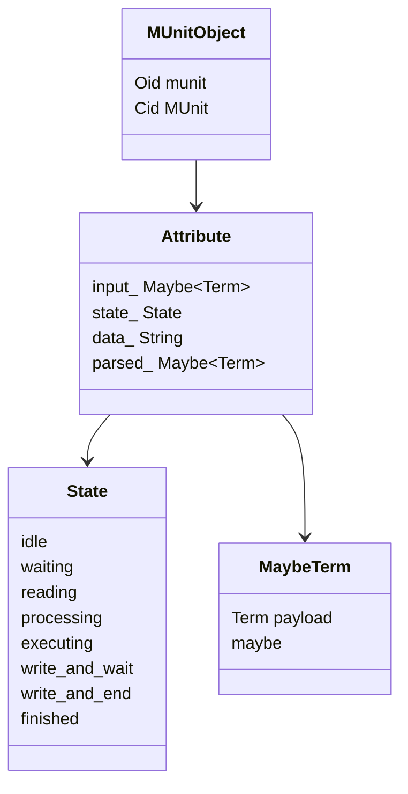

# MUnit — Data Models

> Data structures and models. Generated by codebase-summary.

## Verdict Record

```maude
sort UnitResult .
op <_,_,_> : Nat Nat QidList -> UnitResult [ctor] .
```

- Slot 1: number of passed assertions
- Slot 2: number of failed assertions
- Slot 3: the report — a `QidList` mixing literal text tokens with Maude **color-code tokens**: `'\!` (bold/attention), `'\r` (red), `'\g` (green), `'\o` (reset). `printUR` converts it to a `String` via `printTokens`.

Reports are built compositionally: `procProps` concatenates per-assertion `QidList`s, so totals and details accumulate through the `'[N, N', QIL QIL']` pattern of the predlist equation.

## Session Object Model (`MUNIT-IO`)



- `Maybe{Term}` — parameterized optional value: `subsort X$Elt < Maybe{X}`, constant `maybe` for "absent". Instantiated via `view Term from TRIV to META-TERM (sort Elt to Term)`.
- `data:` accumulates the test file's text **with newlines** (each `gotLine` delivers `"line\n"`; `""` signals EOF and triggers `closeFile`).

## Grammar Datatypes (two-level syntax)

| Sort | Carries | Declared in |
|---|---|---|
| `@Token@` | one raw token (length-1 bubble) — module names, `q`/`quit` args, `open` paths, search modes/bounds, `assertTrueMsg` messages | `COMMANDS`, `MUNIT-SIGNATURE` (op via bubble hook) |
| `@Bubble@` | an arbitrary balanced-parenthesized token run — assertion arguments, patterns, conditions | `MUNIT-SIGNATURE` |
| `@MUnitPredicate@` | one assertion node, e.g. `'assertEqual['bubble[...], 'bubble[...]]` | `MUNIT-SIGNATURE` |
| `@MUnitPredList@` | `[assoc]` juxtaposition `__` of predicates | `MUNIT-SIGNATURE` |
| `@MUnitModule@` | `'munit_is_endu['token[name], predlist]` — the whole test declaration | `MUNIT-SIGNATURE` |
| `@Command@` | `'open_['token[path]]`, `'quit`, `'q` | `COMMANDS` |

The metarepresented shapes consumed by the engine (all built by `metaParse` against `MUNIT-GRAMMAR`/`COMMANDS-GRAMMAR`):

```maude
'munit_is_endu['token[''MODULE.Qid], '__[pred, ..., pred]]
'assertTrue['bubble['even '`( '8 '`)]]
'hasSolution['bubble[...], 'bubble[...], 'token['*], 'token['unbounded], 'bubble[...]]
```

Bubbles hold **unparsed** `QidList`s; the engine resolves them later against the module under test (`solveBubbles`).

## Metarepresented Module Surgery

`addInfoConds(M)` produces a derived `Module` term from the lifted module under test:

- one constant `op qid(string(S)) : nil -> '@Sort@` per user sort `S` (skipping `@Token@`/`@Bubble@`),
- `op '_:_ : S '@Sort@ -> '@Condition@` per sort — enabling `T : Sort` atoms,
- connectives `'_/\_`, `'_=_`, `'_:=_`, `'_=>_` on `@Condition@`,
- `subsort 'Bool < '@Condition@` when `Bool` is present.

`addOps`/`addSorts`/`addSubsorts` rebuild `fmod`/`mod` terms structurally; `override` replaces same-named operator declarations. All are `[memo]`.

## Conditions

`parseCond : Term -> Condition` maps the *parsed* condition metaterm to META-LEVEL `Condition` data:

| Parsed shape | Condition |
|---|---|
| `'_/\_[T, T']` | `parseCond(T) /\ parseCond(T')` |
| `'_=_[T, T']` | `T = T'` |
| `'_:_[T, T']` | `T : getName(T')` |
| `'_:=_[T, T']` | `T := T'` |
| `'_=>_[T, T']` | `T => T'` |
| anything else (a boolean term) | `T = 'true.Bool` |

Search arguments: `Q : Qid` restricted to `'!`, `'*`, `'+`; `BND : Bound` is `unbounded` or a `Nat`.

## External-Object Message Protocol

The session uses the manager/handle pattern: `fileManager` (gated by `-allow-files`), `stdin`/`stdout` standard streams. Message pairs: `openFile`→`openedFile`, `getLine`→`gotLine`, `closeFile`→`closedFile`, `write`→`wrote`; the unhandled `fileError` reply is a known gap (see `review_notes.md`).
