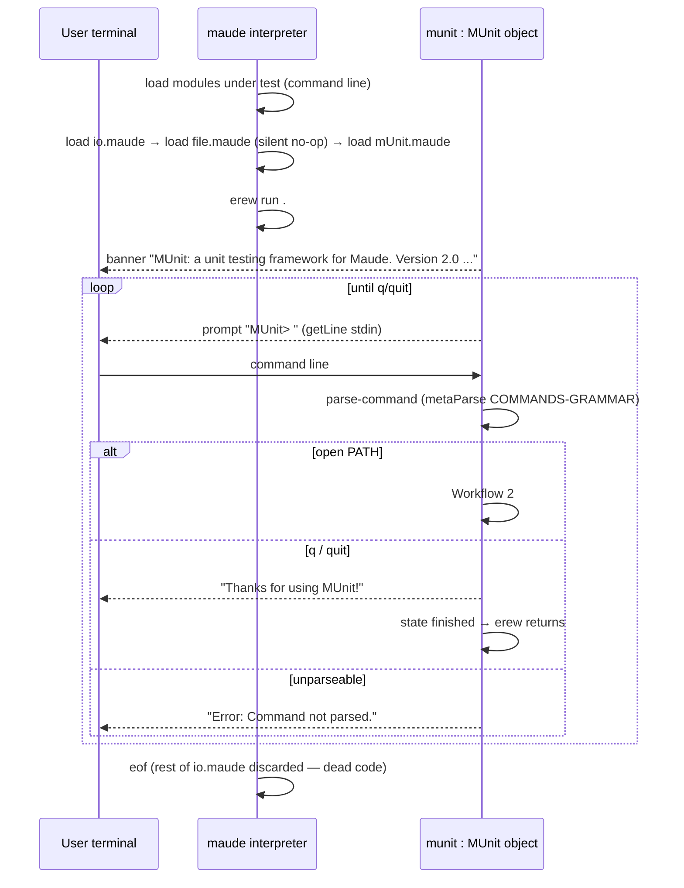
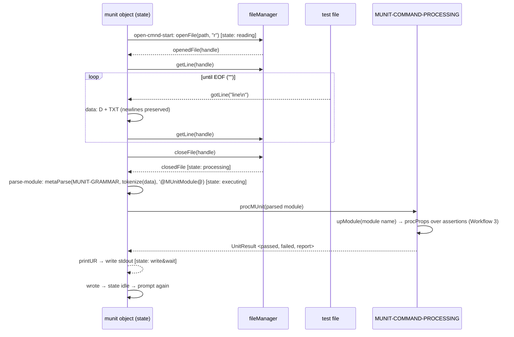
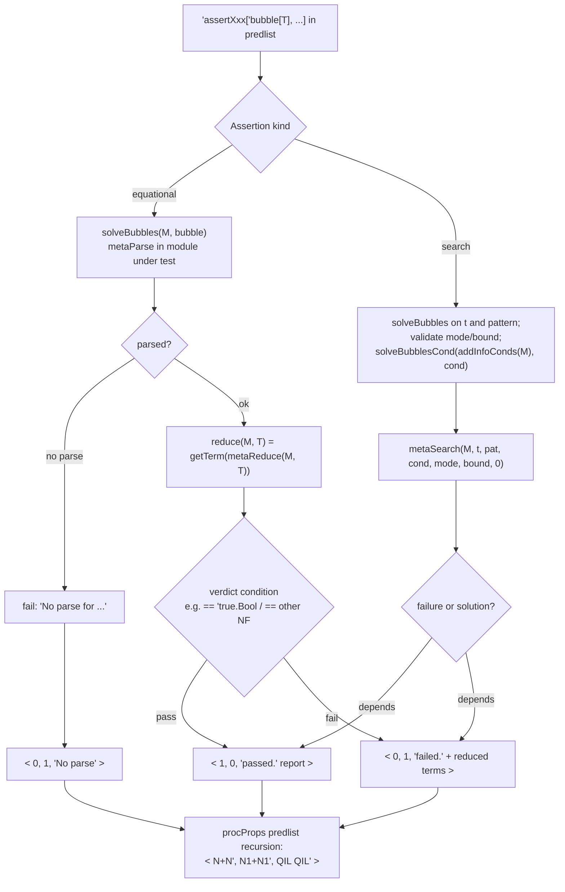

# MUnit — Workflows

> Key processes and workflows. Generated by codebase-summary.

## Workflow 1: Session Lifecycle

## Workflow 2: `open PATH` — Running a Test File

Verified end-to-end with `examples/add_even_test.maude`: 8 test cases, 2 failures, matching the README's documented output.

## Workflow 3: Assertion Evaluation (per assertion)

Key points:
- Each bubble is parsed **exactly once** (`solveBubbles` is `[memo]`) in the module under test.
- Equational verdicts compare normal forms structurally (`==`/`=/=` on metaterms).
- Search verdicts need only the first solution (`metaSearch(..., 0)`); `failure` decides `noSolution`-pass / `hasSolution`-fail.
- Sort assertions read the `ResultPair` type: `metaReduce` returns `{term, sort-or-kind}`; `assertNoSort` matches the kind-level case, `assertSort`/`assertLeqSort` compare the returned sort with `sortLeq`/`sameKind`/`getSorts`.

## Workflow 4: Quit and Teardown

1. `q`/`quit` parsed by `COMMANDS-GRAMMAR` → `[quit-short]`/`[quite-large]` → `write(stdout, munit, byeMsg)`, state `write&end`.
2. `wrote` arrives → `[remove-wrote-end]` → state `finished`.
3. No rules remain and no external requests are pending → **`erew` returns** to the interpreter.
4. The next command in `io.maude` is `eof`, which stops reading the rest of the file — the trailing `set print conceal on`, `print conceal ...`, and `loop init-munit .` lines never execute (verified: `init-munit` is undefined and would be a parse error if reached).
